# Helios

[-f59e0b?style=for-the-badge)](https://github.com)
[](https://www.python.org/)
[](https://www.oracle.com/database/)
[](https://apex.oracle.com/)
[](https://airflow.apache.org/)
[](https://www.docker.com/)

> [!NOTE]
> **Project Status: Work in Progress (WIP)**  
> This project is currently under active development. Architecture, pipelines, and platform features are subject to ongoing development and improvements.

**Helios** is an end-to-end data analytics platform combining modern **Data Engineering**, cloud **Data Warehousing**, and business intelligence (**Oracle APEX**) powered by global power sector transition and decarbonization data from the **Ember Energy API**.

The project implements an enterprise-grade **ELT (Extract-Load-Transform)** pipeline: from REST API extraction, local Bronze Lake storage, and idempotent batch loading into an Oracle Autonomous Data Warehouse (ADW) staging area, to dimensional star modeling in PL/SQL, responsive APEX dashboards, and planned automated executive insights.

---

## 🏛️ System Architecture

```mermaid
flowchart LR
    subgraph Source["Data Source"]
        EmberAPI["Ember Energy API (v1 REST)\n- Electricity Generation\n- Installed Capacity\n- Carbon Intensity\n- Demand & Emissions"]
    end

    subgraph Ingestion["Ingestion & Bronze Lake (Python)"]
        PyClient["ember_client.py\n(requests / standard library)"]
        BronzeLake["🥉 Bronze Data Lake\n(data/raw/*.json)\nRaw 1:1 JSON payloads & Watermarks"]
        StgLoader["StagingLoader\n(python-oracledb mTLS)"]
    end

    subgraph DWH["Cloud Data Warehouse (Oracle ADW & PL/SQL)"]
        STG["Staging Area\n(HELIOS_STG.STG_EMBER_*)"]
        PKG_ELT["PL/SQL Orchestration\n(PKG_EMBER_ELT)"]
        CORE["Star Schema DWH (HELIOS_CORE)\n- DIM_ENTITY, DIM_SERIES, DIM_PERIOD\n- FACT_GENERATION, FACT_CAPACITY\n- FACT_CARBON_INTENSITY, FACT_DEMAND\n- FACT_EMISSIONS"]
        VIEWS["SmartDB Views (SQL Macro)\n(V_FACT_*, PKG_APEX_QUERIES)"]
        LOGGER["Logger (HELIOS_LOGGER)\n(OraOpenSource Logger 3.1.1)"]
    end

    subgraph Presentation["Presentation & Analytics Layer"]
        APEX["Oracle APEX Dashboard\n- Executive KPI Cards, JET Charts\n- System Logs & Admin Control"]
        AI["AI Executive Insights (Roadmap / WIP)\n- Narrative Summaries & Chatbot"]
    end

    EmberAPI -->|REST / JSON| PyClient
    PyClient -->|Raw write| BronzeLake
    BronzeLake -->|Batch Insert / executemany| StgLoader
    StgLoader -->|Idempotent DML| STG
    STG --> PKG_ELT
    PKG_ELT -->|Idempotent MERGE| CORE
    CORE --> VIEWS
    PKG_ELT -.->|Telemetry & Errors| LOGGER
    VIEWS --> APEX
    VIEWS -.->|Planned Integration| AI
    LOGGER --> APEX
```



---

## 🚀 Technology Stack

| Layer / Responsibility | Technologies & Tools | Project Application |
|---|---|---|
| **Extraction & Ingestion** | **Python 3.11+**, `requests`, `python-dotenv` | HTTP client with retry and backoff handling, incremental temporal watermark state tracking. |
| **Database & DWH** | **Oracle Autonomous Data Warehouse (26ai)** | Relational data warehouse on Oracle Cloud Infrastructure (OCI Always Free), star schema, 4-schema least-privilege security model (`HELIOS_STG`, `HELIOS_CORE`, `HELIOS_APEX`, `HELIOS_LOGGER`). |
| **Database Connectivity** | `python-oracledb` (Thin mode + mTLS) | High-performance batch data loading (`executemany`) utilizing Oracle Wallet without requiring local Oracle Client installation. |
| **DWH Transformation & Business Logic** | **Oracle SQL & PL/SQL** | Idempotent `MERGE` pipelines, window analytical functions (`LAG`, `LEAD`, `RATIO_TO_REPORT`), SmartDB views, and SQL Macro table providers. |
| **Logging & Telemetry** | **OraOpenSource Logger 3.1.1** | PL/SQL code instrumentation, hierarchical scope tracking, parameter logging, call stack capture, and zero unhandled exception policy. |
| **Workflow Orchestration** | **Apache Airflow 2.10+**, Docker Compose | Multi-dataset parallel extraction DAGs (TaskFlow API), task dependency management, scheduling, and containerized deployment. |
| **Presentation & BI** | **Oracle APEX 26.x**, APEXlang (`.apx`) | Interactive renewable energy dashboard, KPI cards, JET charts, administrative log explorer with runtime log level switching (`logger.set_level`). |
| **Artificial Intelligence** | **Google Gemini API** (`google-genai` SDK - Planned) | Automated narrative executive reporting (*Automated Executive Insights*) and conversational analytics (Text-to-SQL). |
| **Code Quality & Testing** | `pytest`, `pytest-mock`, `ruff`, `apexctl` | Fast offline unit testing with mocks, live integration tests (Oracle ADW & Ember API), E2E pipeline tests, and APEXlang AST validation. |

---

## 📂 Repository Structure

```text
helios/
├── dags/                            # Apache Airflow DAGs (TaskFlow API)
│   └── helios_elt_dag.py            # Primary ELT DAG: Extraction -> Staging -> Core
├── data/                            # Local data store
│   ├── raw/                         # 🥉 Bronze Lake: raw 1:1 JSON payload dumps
│   ├── watermarks/                  # Incremental temporal watermark registry
│   └── samples/                     # Offline API sample mock payloads
├── db/                              # Oracle SQL & PL/SQL database codebase (Version controlled)
│   ├── deploy.sql                   # Master deployment script
│   ├── 00_admin/                    # Schema administration (HELIOS_STG, CORE, APEX, LOGGER)
│   ├── 01_logger/                   # OraOpenSource Logger 3.1.1 installer and grants
│   ├── 02_stg/                      # Landing tables: STG_EMBER_*
│   ├── 03_core/                     # Star schema: DIM_*, FACT_*, PKG_EMBER_ELT*, SmartDB views
│   └── 04_apex/                     # Synonyms, SQL Macro package PKG_APEX_QUERIES, APEXlang (.apx)
├── src/helios/                      # Application Python package
│   ├── client/                      # Ember Energy API HTTP client
│   ├── db/                          # Oracle ADW connector (mTLS connection pool, context managers)
│   └── elt/                         # ELT pipeline modules: extraction (E), load (L), transform (T)
├── tests/                           # Test suite
│   ├── unit/                        # Fast unit tests with MagicMock
│   ├── integration/                 # Integration tests with live Oracle ADW and Ember API
│   └── e2e/                         # End-to-End pipeline execution tests
├── Dockerfile                       # Extended Airflow image with Helios dependencies
├── docker-compose.yml               # Multi-container Apache Airflow setup
└── pyproject.toml                   # Project dependencies and tool configurations
```

---

## ⚙️ Quickstart & Setup Guide

### 1. Prerequisites
* **Python 3.11+**
* **Docker Desktop** (for running Apache Airflow containers)
* An active **Oracle Database** instance (Oracle ADW Always Free on OCI recommended) with downloaded mTLS `wallet/`
* An **Ember Energy API Key** ([Free registration](https://ember-climate.org/data/api/))

### 2. Environment Configuration
Create a `.env` file in the project root:
```dotenv
# Ember Energy API
EMBER_API_KEY=your_ember_api_key_here

# Database Connection (Oracle ADW)
ORACLE_DSN=your_db_low
ORACLE_WALLET_DIR=./wallet/wallet_ADW
ORACLE_WALLET_PASSWORD=your_wallet_password

# Pipeline Schema Credentials
HELIOS_STG_USER=helios_stg
HELIOS_STG_PASSWORD=your_stg_password
HELIOS_CORE_USER=helios_core
HELIOS_CORE_PASSWORD=your_core_password

# Optional: Admin Account (for integration tests and admin tasks)
ORACLE_ADMIN_USER=admin
ORACLE_ADMIN_PASSWORD=your_admin_password
```

### 3. Python Environment Setup
```bash
python -m venv venv

# Windows:
.\venv\Scripts\activate
# Linux/macOS:
source venv/bin/activate

pip install -e .
```

### 4. Running Tests
```bash
# Unit tests (isolated offline testing with mocks):
pytest tests/unit

# Integration tests (live Oracle ADW and Ember API):
pytest tests/integration

# End-to-End pipeline tests:
pytest tests/e2e
```

### 5. Pipeline Orchestration with Airflow
```bash
docker compose up -d
```
Access the Apache Airflow web interface at: `http://localhost:8080` (default credentials: `airflow` / `airflow`).  
The primary DAG to trigger is: `helios_elt_pipeline`.

---

## 🙏 Acknowledgments

The Helios project is built upon the invaluable contributions of two open technologies:

1. **[Ember Climate (Ember Energy API)](https://ember-climate.org/)**  
   Special thanks to the **Ember** team for providing a comprehensive, reliable, and openly accessible REST API covering global electricity generation, capacity additions, and emissions. Their commitment to data transparency plays a vital role in accelerating the global clean energy transition.

2. **[OraOpenSource Logger](https://github.com/OraOpenSource/Logger)**  
   Heartfelt appreciation to **Martin G缺rlandt**, **Tyler Muth**, and the entire **OraOpenSource** community for creating **Logger**. It remains the gold standard for PL/SQL instrumentation, telemetry, and debugging in Oracle Database. Logger provides Helios with rock-solid execution tracing, hierarchical parameter logging, and error call stack capture.

---

## 📄 License

This project is licensed under the **MIT License**. See the [LICENSE](LICENSE) file for details.